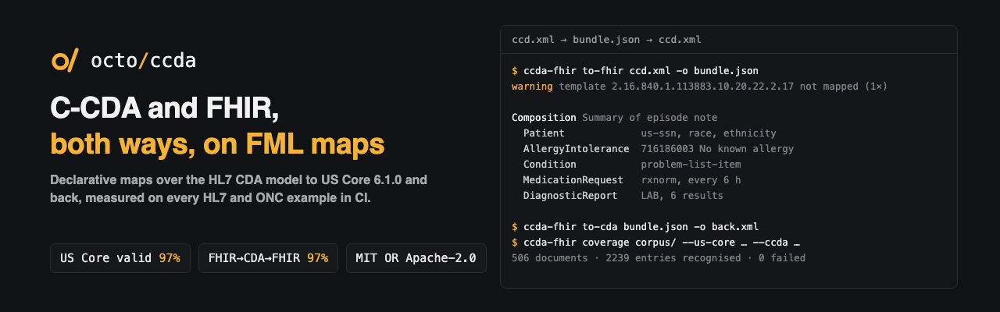

<p align="center"></p>

<p align="center"><b>C-CDA ⇄ FHIR R4 (US Core 6.1.0), both ways, as FHIR Mapping Language maps over the HL7 CDA logical model.</b></p>

<p align="center">
  <a href="https://github.com/octofhir/ccda-fhir/actions/workflows/ci.yml"></a>
  <a href="#license"></a>
</p>

```sh
ccda-fhir to-fhir ccd.xml -o bundle.json --report report.json   # a FHIR document Bundle
ccda-fhir to-cda bundle.json -o ccd.xml                          # and back
ccda-fhir check                                                  # type-check the maps
ccda-fhir coverage corpus/ --us-core <pkg> --ccda <pkg>          # measure a corpus
```

The conversion is declarative. Each direction is a set of [FML](https://build.fhir.org/ig/HL7/mapping-language-ig/)
maps (`maps/cda2fhir`, `maps/fhir2cda`) run by the [fml-rs](https://github.com/octofhir/fml-rs)
engine over the HL7 CDA logical model (`hl7.cda.uv.core`) and the C-CDA templates
(`hl7.cda.us.ccda`). XML is read into the model and written back by `fml-xml`. The tables of
[C-CDA on FHIR 2.0.0](https://hl7.org/fhir/us/ccda/STU2) are the specification; its ConceptMaps
are used as published.

## What it converts

| | CDA → FHIR | FHIR → CDA |
|---|---|---|
| Header | Composition, Patient (race, ethnicity, language, guardian, birth place), Practitioner / PractitionerRole / Organization by the participations mapping (a participant named only by its id is the practitioner described elsewhere), Device, attester, event | US Realm Header (C-CDA 5.0.0), CCD |
| Allergies | AllergyIntolerance: status, type and category, reactions and severity, criticality, no known allergies | Allergy Concern act, Allergy Intolerance observation |
| Problems | Condition (problems and health concerns): category by section, status, onset and abatement, date of diagnosis, supporting observations as evidence | Problem Concern act, Problem observation |
| Medications | MedicationRequest: intent, status, dosage and timing (PIVL_TS, EIVL_TS), maximum dose, supply order, sig; a Medication (US Core) when the product has more than a code (id, form, manufacturer, vehicle); admission and discharge medications | Medication Activity (with Drug Vehicle), Admission and Discharge Medication |
| Immunizations | Immunization: status, not-given reason, lot, manufacturer, performer | Immunization Activity |
| Results | DiagnosticReport (Lab) with laboratory Observations: every value type (non-UCUM units included), reference ranges, specimens (US Core Specimen) | Result Organizer, Result Observations, specimen |
| Vital signs | Vital signs panel with member Observations | Vital Signs Organizer |
| Procedures | Procedure: status, performed, body site, performers, location, reasons, devices | Procedure Activity Procedure |
| Encounters | Encounter (Encounter Activity and the header encompassingEncounter, one resource when they share an id): status, class from V3 ActCode or CPT E&M codes, type, period, discharge disposition, participants, Location, reasons, encounter diagnoses (with admission and discharge diagnoses as their role) | Encounter Activity with Service Delivery Location, Indication and Encounter Diagnosis; componentOf/encompassingEncounter |
| Social history | Smoking status, pregnancy status (with the estimated delivery date) and intent, sexual orientation, screening and assessment (assessment scales with their answers), other social history observations; birth sex, sex, gender identity and tribal affiliation as Patient extensions | Smoking Status, Pregnancy, Pregnancy Intention, Sexual Orientation, Assessment Scale, Social History Observation; the Patient extensions as their observations |
| Notes | DocumentReference (clinical-note) from Note Activity in any section: type, content (inline base64 as sent, or the narrative it refers to as XHTML), author, date, encounter, related documents | Note Activity with the content inline and its text in the section narrative |
| Goals and plan of treatment | Goal (description, target, start and due); planned observations, procedures, encounters and acts and referrals as ServiceRequest (intent from the mood); planned medications as MedicationRequest; Assessment and Plan the same way | Goal Observation, Planned Procedure |
| Functional and mental status | Observations of the functional-status and cognitive-status categories (organizers as panels, assessment scales as screening and assessment); functional and cognitive status problems as Conditions | Functional and Mental Status organizers and observations, Assessment Scale |
| Family history | FamilyMemberHistory: relationship, sex, birth, death, conditions with age at onset and cause of death | Family History Organizer, Observation, Age and Death Observations |
| Medical equipment | Device (US Core implantable device for implants: UDI carrier, lot, serial, dates, model, manufacturer) as a procedure's focal device or from a supply | Product Instance with UDI Organizer, Non-Medicinal Supply Activity |
| Diagnoses and health concerns | Admission and discharge diagnoses as encounter diagnoses; Health Concern Acts as health-concern Conditions | Hospital Admission and Discharge Diagnosis, Health Concern Act |
| Discharge medications | MedicationRequest of the discharge category | Discharge Medication |

Sections and entries are recognised by any of their template ids, in any version, and the
"entries optional" templates of earlier releases; entries of a section the maps do not know are
still converted by their own templates, and narrative-only sections (chief complaint, hospital
course, discharge instructions and the like) keep their template both ways. Narrative becomes XHTML and back. Identifiers
follow the guidance: OIDs to URIs through HL7 Terminology, `urn:oid:` and `urn:uuid:` otherwise.
Timestamps keep their precision and time zone. Identical Practitioners and Organizations are
merged.

## Measured

Every CI run converts the HL7 C-CDA and CDA examples and the ONC test data (all CC0; fetched by
`scripts/fetch-corpus.sh`, measured by `scripts/metrics.sh`) and writes
[reports/corpus.md](reports/corpus.md):

| | |
|---|---|
| Documents | 506 (199 documents, 307 section examples in a minimal document); 0 failed |
| Entries recognised | 94.8% (sections 95.4%); the rest are listed by template in the report |
| FHIR resources valid against US Core 6.1.0 | 99.7% |
| CDA written back conforming to the C-CDA 5.0.0 templates | 92.2% of documents, 99.7% of templated elements |
| Round trip CDA → FHIR → CDA, significant values kept | 73.1% |
| Round trip FHIR → CDA → FHIR, significant values kept | 98.7% |
| Agreement with the C-CDA on FHIR consensus outputs | 88.8%: every value of the recommended allergy, problem, procedure, immunization, patient and encounter resources; the drafts' differences from the tables are listed in the report |

The CDA round trip loses what C-CDA on FHIR maps to nothing: the ids and times of concern acts,
the allergy observation's value (FHIR keeps only its type and category), a second author. Every
conversion reports what it could not carry over — elements outside the model, templates not
mapped, codes a ConceptMap has no target for — with the path and the line in the XML.

US Core validity is checked with the [fhirschema](https://github.com/octofhir/fhirschema)
validator; C-CDA conformance by the templates' StructureDefinitions (cardinality, fixed and pattern
values, invariants; not slices or terminology). FHIR → CDA follows the C-CDA on FHIR tables, which
HL7 marks as a single-vendor mapping without multi-vendor consensus; results, encounters, social
history and notes have no FHIR → CDA table and are the reverse of the CDA → FHIR one, written to
the C-CDA 5.0.0 templates.

Beyond the tables: goals, plans of treatment, functional and mental status, family history,
medical equipment and discharge medications have no C-CDA on FHIR table at all; their maps follow
the C-CDA 5.0.0 templates and the US Core profiles, and their descriptions say so. Hospital
admission and discharge diagnoses are encounter diagnoses with their role; Encounter class and type, Location name and DiagnosticReport issued, which US Core requires,
are data-absent when the document does not give them (as the mapping's own examples do).

## Writing maps

[docs/writing-maps.md](docs/writing-maps.md): what runs in which order, the JSON a map sees, how
templates route, where each kind of rule lives, the FML and FHIRPath traps, and how to try and
measure a change.

## Library

```rust
let converter = ccda_fhir::Converter::new().await?;   // embedded maps, models, ConceptMaps
let fhir = converter.to_fhir(xml, &ccda_fhir::Options::default()).await?;
let outcome = fhir.report.to_operation_outcome();     // what was not carried over
let cda = converter.to_cda(&fhir.bundle, &ccda_fhir::Options::default()).await?;
```

Everything is embedded: no files, no network. `Converter::with_maps` runs other maps, to work on
them without rebuilding (`ccda-fhir --maps maps/ …`).

## Data

`data/` holds what the converter needs from HL7 packages, all CC0-1.0 (see
[data/SOURCES.md](data/SOURCES.md), regenerated by `scripts/vendor.py`): the CDA model and C-CDA
templates (`hl7.cda.uv.core` 2.0.3-sd, `hl7.cda.us.ccda` 5.0.0), the ConceptMaps of C-CDA on FHIR
2.0.0, and OID ⇄ URI maps from HL7 Terminology 7.5.0.

## License

MIT OR Apache-2.0, at your option.
